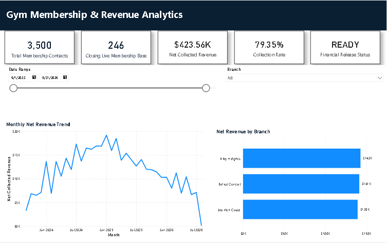
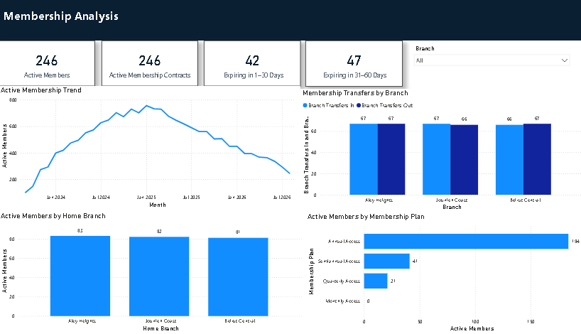
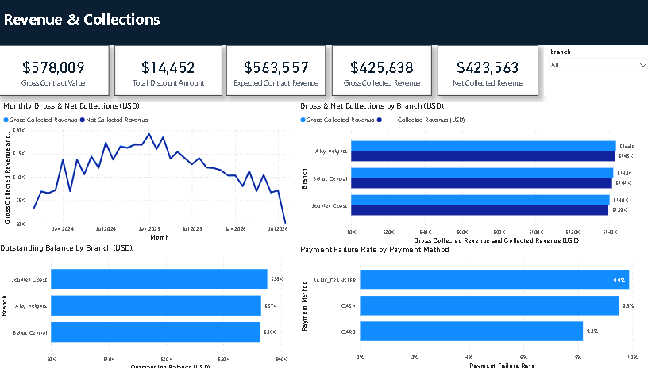
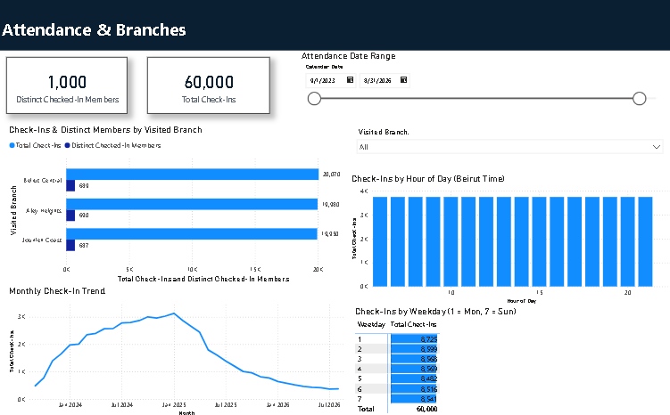
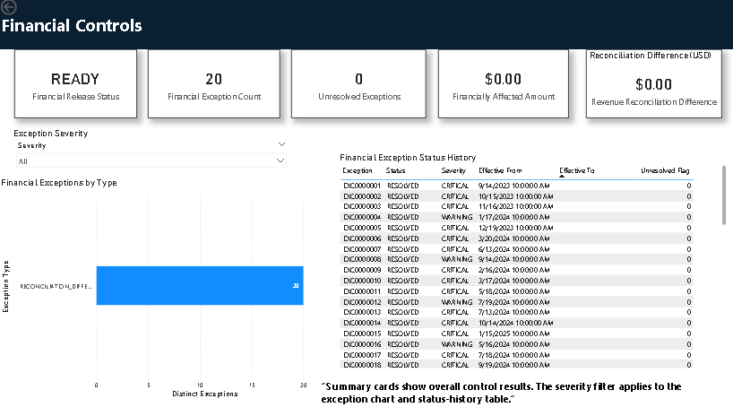

Gym Membership & Revenue Analytics
MySQL · Power BI · SQL · DAX · Data Modeling · Data Validation

An end-to-end analytics portfolio project for a fictional gym business operating in Aley Heights, Beirut Central, and Jounieh Coast. It connects a controlled MySQL data model to five Power BI report pages covering memberships, revenue, collections, attendance, and financial controls.

Author: Daniel Andari
Reporting period: September 1, 2023–August 31, 2026
Currency: USD
Data: Deterministic synthetic data; no real customer records or actual gym performance are represented.
Business problem
A multi-branch gym needs consistent answers to practical questions:
- How many memberships remain active, and which contracts are approaching expiration?
- How much cash has been collected, refunded, or left outstanding?
- How do branches compare in membership, attendance, and collections?
- Which payment methods have the highest failure rates?
- Are the financial results reconciled and ready to report?
This project establishes consistent KPI definitions, preserves historical events, and separates operational activity from approved reporting outputs.
Selected results
These results were compared with MySQL outputs during the Power BI review. Transaction totals use the historical reporting period; membership counts use the closing snapshot. See the [project report](GYM_MEMBERSHIP_REVENUE_ANALYTICS_PROJECT_REPORT.md) for definitions, evidence, and limitations.
Metric	Result	Scope
Membership contracts	3,500	Contract count confirmed against SQL
Closing active members	246	August 31, 2026 snapshot
Contracts expiring in 1–30 days	42	Closing snapshot
Contracts expiring in 31–60 days	47	Closing snapshot
Gross collected revenue	$425,637.73	Historical transaction period
Refund amount	$2,074.61	Historical transaction period
Net collected revenue	$423,563.12	Gross collections less refunds
Collection rate	79.35%	Net applied amount / collectible obligations
Outstanding balance	$110,574.89	Current balance of obligations due within the reporting period
Check-ins	60,000	Historical attendance period
Distinct checked-in members	1,000	Across all visited branches
Financial release status	READY	At the validated control evaluation

Findings and decision support
- Upcoming expirations: 42 contracts fall in the next 1–30-day window and 47 in the 31–60-day window. These groups support renewal outreach; they do not establish a churn prediction.
- Collection follow-up: $110,574.89 remains outstanding on obligations due within the reporting period. This is not automatically all overdue debt; an ageing breakdown is needed to prioritize follow-up.
- Payment reliability: Bank transfers show a 9.9% failure rate, cash 9.5%, and cards 8.2%, using failed attempts divided by finalized attempts. Investigating failure reasons is a proposed next analysis, not a demonstrated cause.
- Branch attendance: Check-in volumes are close across branches: Beirut Central 20,070, Aley Heights 19,980, and Jounieh Coast 19,950. Members can visit multiple branches, so branch-level distinct-member counts must not be added to obtain the company total.
- Financial controls: The validated summary reports 20 exceptions in total, zero unresolved exceptions, and a $0.00 revenue reconciliation difference. Historical OPEN or UNDER_REVIEW rows represent earlier statuses and do not contradict the current unresolved count.
These observations describe the synthetic scenario and demonstrate analytical methods, not real-world business outcomes.
Power BI report pages
Page	Main purpose
Executive Overview	Membership base, net collections, collection rate, release status, and revenue trends
Membership Analysis	Active members and contracts, expiration windows, plan mix, home branches, and transfers
Revenue & Collections	Contract value, discounts, expected revenue, gross/net collections, outstanding balances, and payment failures
Attendance & Branches	Check-ins and distinct visitors by visited branch, month, Beirut hour, and weekday
Financial Controls	Exception totals, unresolved exposure, reconciliation, severity filtering, and status history

Dashboard screenshots and the final report download will be added during repository packaging.
Architecture and skills demonstrated
Operational MySQL tables → reporting views and analytical marts → curated analytical views → Power Query and Power BI model → DAX measures and report visuals.

The source package documents 21 operational tables, 32 history-protection triggers, 20 controlled procedures, 25 initial validation/reporting views, 10 additional analytical views, and 3 indexed marts. The analytical layer therefore adds three tables to the operational inventory.

The project demonstrates relational modeling, effective-dated history, financial reconciliation, window functions and analytical SQL, materialized reporting data, role-based read access, DAX filter context, snapshot measures, and SQL-to-report validation.

Four branch roles remain distinct: home branch, financial ownership branch, visited branch, and payment processing branch. Date logic similarly distinguishes transaction dates, obligation due dates, and membership snapshots.
Validation and limitations
The archived SQL acceptance record reports an eight-control final gate with 8 PASS, 0 FAIL, and READY. The five-page Power BI report was reviewed through screenshots, user-confirmed SQL comparisons, and inspection of saved report settings.

The November 2026 file review did not rerun MySQL or recalculate the embedded Power BI model. The lightweight SQL gate verifies deployment, population, primary keys, and grant coverage; it is not a substitute for the separate dataset reconciliation and workflow tests.

The synthetic dataset is fixed. Its analytical marts are not presented as a production incremental-refresh pipeline. Reported financial balances and readiness are not automatically historical as-of measures.
Project documentation and publication status
The [updated project report](GYM_MEMBERSHIP_REVENUE_ANALYTICS_PROJECT_REPORT.md) explains the design, validated results, reporting rules, and remaining publication work.

The source archive contains 36 SQL scripts and 35 Markdown documents, including requirements, a KPI catalogue, data models, test reports, and analytical-layer reviews. The original SQL-phase documents remain historical records.

Status: SQL implementation and five-page Power BI report are built; portfolio packaging is in progress. GitHub publication and a clean-environment reproduction check are pending. Before publishing setup instructions, the build/validation order must be reconciled: the structural master invokes a grants validator whose audit count already expects the later analytical layer.

No business-performance improvement, production deployment, or independent validation of all 51 catalogue KPIs is claimed.

## Dashboard previews

### Executive Overview

### Membership Analysis

### Revenue & Collections

### Attendance & Branches

### Financial Controls

